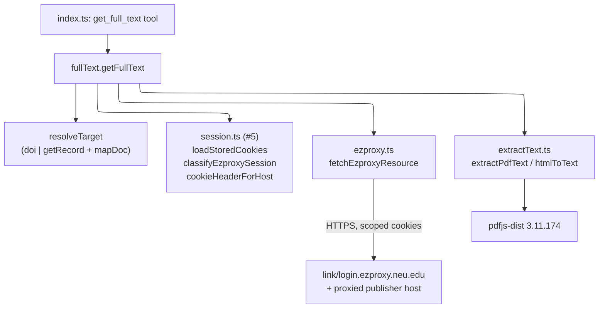
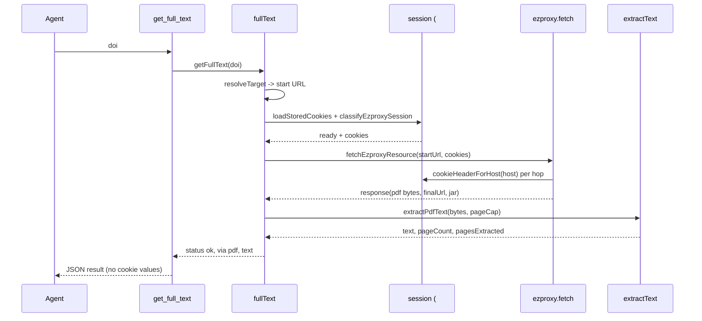
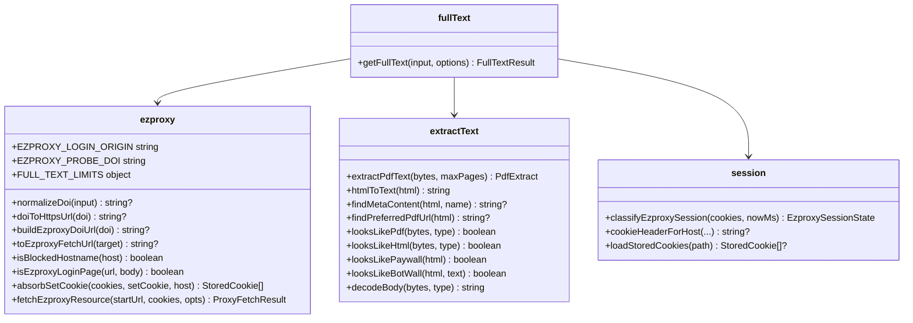
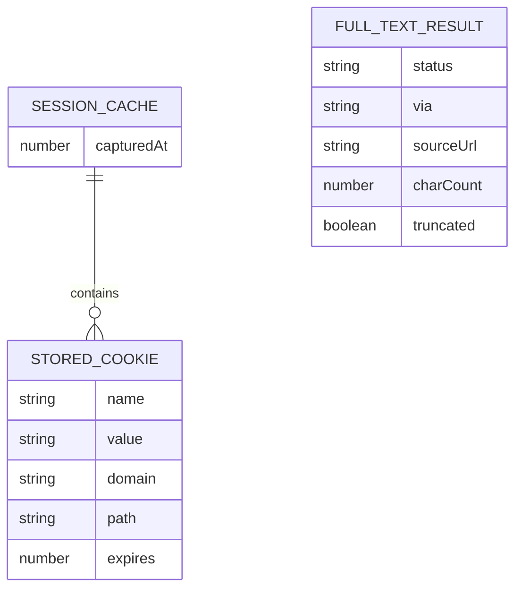
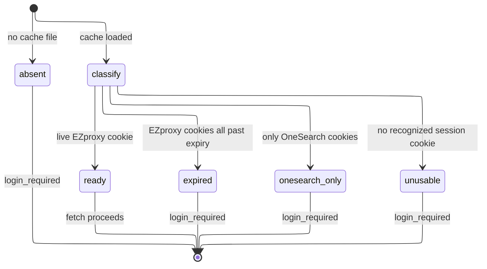
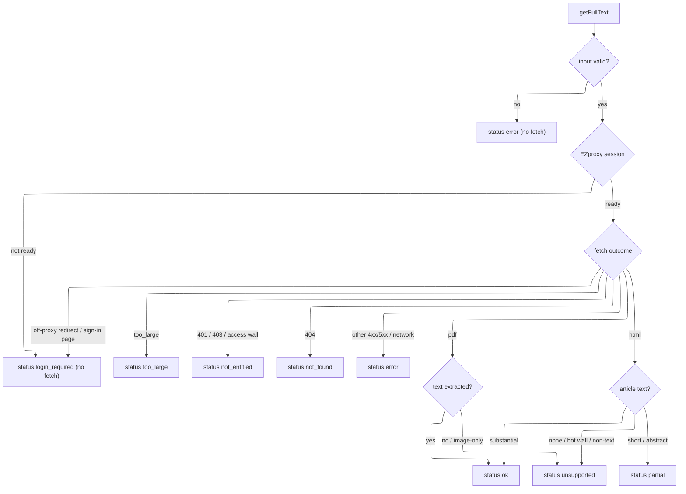

# Design Document

## Overview

`get_full_text` is a new MCP tool that turns a DOI or an alma record id into the
plain text of the underlying article, fetched through NEU EZproxy with the
session issue #5 captured. The design ports PR #2's full-text logic onto the
current modules without copying PR #2's session or login code.

The port splits across three source files:

- `src/ezproxy.ts` gains the fetch path: URL building, an SSRF host guard, a
  manual redirect follower that stays on `*.ezproxy.neu.edu`, a byte-capped body
  reader, and `Set-Cookie` absorption. It reuses #5's `cookieHeaderForHost`,
  `isEzproxyHostname`, and `StoredCookie` rather than redefining them.
- `src/extractText.ts` is new: PDF text extraction (via `pdfjs-dist`) and HTML
  to text, plus publisher/paywall/bot-wall heuristics. No network, no session.
- `src/fullText.ts` is new: the orchestration that resolves the target, checks
  the session, drives the fetch, and maps every outcome to a structured result.

The tool registers in `src/index.ts` next to `search_onesearch` and
`get_record`. A `scripts/fulltext-smoke.mjs` script and README notes cover the
manual live check.

Requirement coverage: R1 (target resolution) is handled by `resolveTarget` and
the mapper's existing `doi`/`fullTextUrl`/`ezproxyDoiUrl` fields. R2 (session
and cookie scoping) reuses #5's `loadStoredCookies`/`cookieHeaderForHost` plus a
new EZproxy-specific classifier. R3 (extraction, caps, statuses) is `extractText`
plus `fullText`'s status mapping. R4 (docs) is the README and smoke script.

### Decisions

| Decision | Why | Rejected alternative |
| --- | --- | --- |
| Add a thin `classifyEzproxySession`/`EzproxySessionState` to #5's `session.ts`, built on its existing `hasEzproxySession`/`hasOneSearchSession`/`isCookieExpired` | Full text needs an EZproxy cookie; a OneSearch-only session must map to `login_required`. #5's `classifySession` treats OneSearch-only as `ready`, which is correct for anonymous tools but wrong here | Reintroducing PR #2's parallel `session.ts` (forbidden by the issue); overloading #5's `classifySession` and breaking its contract |
| Reuse #5's cache location (`sessionCachePath`, `NEU_ONESEARCH_CACHE_DIR`) and `loadStoredCookies` | Single source of truth for the session; the login CLI already writes there | PR #2's `NEU_ONESEARCH_SESSION_PATH` + `~/.neu-onesearch-mcp/session.json`, which no longer matches #5 |
| Keep PR #2's full status set (`ok`, `partial`, `login_required`, `not_entitled`, `not_found`, `too_large`, `unsupported`, `error`) | The issue lists `ok/login_required/not_entitled/unsupported/too_large` as required and says "plus"; the extra three (`partial`, `not_found`, `error`) are honest intermediate outcomes already exercised by PR #2's tests | Collapsing to five, which would force misleading statuses for 404s, short HTML, and bad input |
| Pin `pdfjs-dist` to `3.11.174` exactly | `extractText.ts` targets the 3.x `legacy/build/pdf.js` API and `GlobalWorkerOptions.workerSrc`; pdfjs 4+ is ESM-only with a changed API. Exact pin per CONTRIBUTING | A caret range or 4.x, which could break the build on a minor bump |
| Follow `citation_pdf_url` only after re-routing it through `toEzproxyFetchUrl` and the SSRF guard | A publisher PDF link must not be fetched directly (leaks no proxy session, and a hostile link must not reach localhost/RFC1918) | Fetching the publisher URL as-is |
| Mock EZproxy and publishers in every test via an injected `fetchImpl` | No NEU credentials in CI; keeps tests hermetic and lets them assert no cookie leaks | A live integration test, which cannot run in CI |

## Architecture

`get_full_text` is request/response within one process. The only external call
is HTTPS to EZproxy. Session state is read-only from the on-disk cache.

Sequence of a successful PDF retrieval:

## Components and Interfaces

New and changed exports. Signatures the tasks implement:

Key types:

- `FullTextStatus = 'ok' | 'partial' | 'login_required' | 'not_entitled' | 'not_found' | 'too_large' | 'unsupported' | 'error'`
- `GetFullTextInput = { doi?: string; recordId?: string }`
- `GetFullTextOptions = { fetchImpl?; sessionPath?; nowMs?; maxDownloadBytes?; maxTextChars?; maxPdfPages?; maxRedirects?; timeoutMs? }` — `fetchImpl` and `sessionPath` make the tool testable; defaults use the global `fetch` and #5's `sessionCachePath()`.
- `FullTextResult = { status, doi, recordId, title, sourceUrl, contentType, via, pageCount, pagesExtracted, truncated, charCount, text, message, limits }`.
- `EzproxySessionState = 'ready' | 'absent' | 'expired' | 'onesearch_only' | 'unusable'`.

The tool handler in `index.ts` calls `getFullText`, serializes the result as
pretty JSON in a text block, and (unlike `search_onesearch`) does not throw
`LoginRequiredError`: `getFullText` already returns `login_required` as data, so
the handler stays a thin adapter.

## Data Models

No persisted entities are added. The tool reads the existing session cache that
#5 defined and never writes it. The in-memory cookie jar lives only for the
duration of one fetch chain.

The session classifier is a read-only lifecycle over the cached cookies:

## Error Handling

Every failure is a `FullTextResult` status, never a thrown error out of
`getFullText`. `getRecord` can throw `LoginRequiredError` for the metadata
lookup; `resolveTarget` lets that surface as `login_required` through the tool
handler's existing catch, consistent with #5.

Secret safety (R2.4): cookie values are only ever placed in the outbound
`Cookie` header by `cookieHeaderForHost`. No status, message, `sourceUrl`, or
thrown error includes a cookie value. Tests assert the serialized result never
contains the fixture cookie.

## Testing Strategy

All tests mock EZproxy and publishers through the injected `fetchImpl`; none need
a Northeastern account. Vitest, matching the existing suite.

- `test/extractText.test.ts`: HTML meta/paywall parsing, `htmlToText` dropping
  scripts and nav, and PDF extraction + page cap against `test/fixtures/tiny.pdf`.
- `test/fullText.test.ts`: input validation, `login_required` for
  absent/OneSearch-only/expired sessions without fetching, cookie-scoping on the
  outbound header, PDF and HTML happy paths, `citation_pdf_url` re-routed through
  EZproxy, SSRF guard on a private citation PDF host, access wall / 403 ->
  `not_entitled`, EZproxy sign-in page -> `login_required`, caps -> `truncated`,
  alma `recordId` resolution, and an assertion that no result echoes the cookie.
- `test/session.test.ts` (extend): `classifyEzproxySession` returns `ready`,
  `expired`, `onesearch_only`, `unusable`, and `absent` for the matching cookie
  fixtures, without disturbing #5's `classifySession` cases.

The live retrieval named in R4.2 is a manual check run with a real session; it is
listed in the PR testing notes, not automated.
