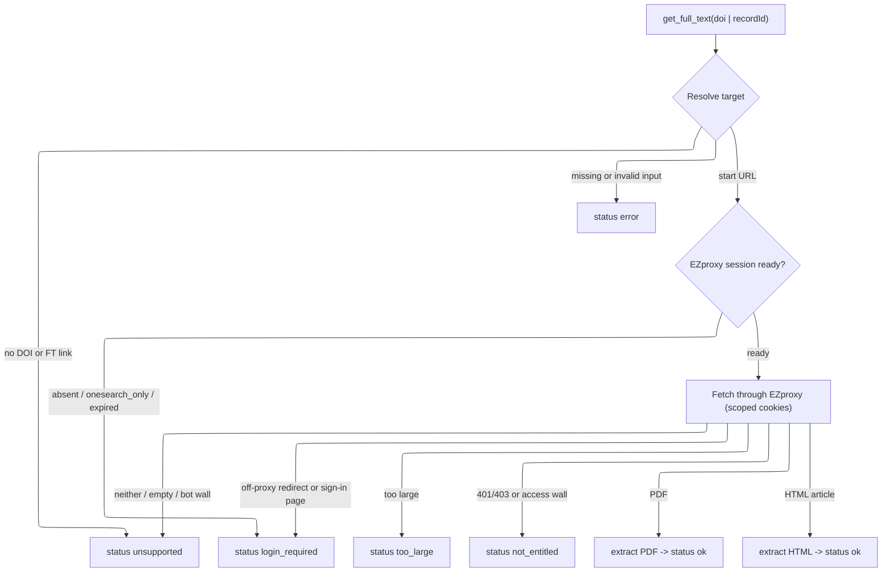

# Requirements Document

## Introduction

Add a `get_full_text` MCP tool that retrieves and extracts the plain text of an
article Northeastern subscribes to, fetched through the library EZproxy using the
cached session from issue #5. The work is a port of the full-text prototype in
closed PR #2 onto the current session layer: it reuses #5's cache, cookie
scoping (`cookieHeaderForHost`), and `LoginRequiredError`/`login_required`
handling, and does not reintroduce PR #2's own session and login modules.

Scope and non-goals, decided here so drafting can proceed:

- In scope: the `get_full_text` tool, an EZproxy fetch path with SSRF and size
  guards, PDF and HTML text extraction with caps, structured result statuses, a
  manual smoke script, and README docs for both.
- Out of scope / deferred: browser-rendered (JavaScript-only) articles, OCR of
  scanned PDFs, CAPTCHA solving, and any new login or session-capture code. The
  tool only reads the session that `neu-onesearch-login` already wrote.
- No credentials are available in CI or development, so every test mocks EZproxy
  and publisher responses; a live retrieval is a manual check in the PR.

The anonymous tools (`search_onesearch`, `get_record`) keep working with no
session; only `get_full_text` requires an EZproxy session.

## Requirements

### Requirement 1

**User Story:** As an agent, I want to request the full text of an article by
DOI or OneSearch record id, so that I can read and synthesize the source instead
of only its metadata.

#### Acceptance Criteria

1. WHEN `get_full_text` is called with a `doi` (bare, `doi:`-prefixed, or a
   `https://doi.org/` URL) THEN the system SHALL resolve it to a DOI and build an
   EZproxy start URL on `link.ezproxy.neu.edu`.
2. WHEN `get_full_text` is called with an alma `recordId` and no `doi` THEN the
   system SHALL load that catalog record, derive its DOI or EZproxy full-text
   link, and use it as the start URL.
3. WHEN neither `doi` nor `recordId` is provided THEN the system SHALL return
   status `error` with a message naming both inputs and SHALL NOT make a network
   request.
4. WHEN the `doi` is not a valid DOI, or the `recordId` is not an alma id, THEN
   the system SHALL return status `error` without fetching.
5. WHEN the catalog record has neither a DOI nor an EZproxy full-text link THEN
   the system SHALL return status `unsupported` without fetching.

### Requirement 2

**User Story:** As a Northeastern user, I want full-text retrieval to use my
saved library session and to tell me plainly when it is gone, so that an expired
session never looks like a crash.

#### Acceptance Criteria

1. WHEN no session cache exists, or it holds only OneSearch cookies, or its
   EZproxy cookies are all expired THEN the system SHALL return status
   `login_required`, SHALL still report the resolved `sourceUrl`, and SHALL NOT
   make a network request.
2. WHEN a usable EZproxy session exists THEN the system SHALL send only the
   cookies scoped to the requested EZproxy host, via #5's `cookieHeaderForHost`.
3. WHEN EZproxy redirects the fetch to a host outside `*.ezproxy.neu.edu`
   (the NU IT sign-in path), or returns its own sign-in page, THEN the system
   SHALL return status `login_required` and SHALL NOT send session cookies to
   that off-proxy host.
4. THE SYSTEM SHALL NOT log, return, or otherwise expose any cookie value in a
   result, message, or error.

### Requirement 3

**User Story:** As an agent, I want the retrieved content turned into bounded
plain text with a clear status, so that I get usable text or an honest reason it
could not be delivered.

#### Acceptance Criteria

1. WHEN the proxied response is a PDF THEN the system SHALL extract text up to
   the page cap, set `via` to `pdf`, and report `pageCount` and
   `pagesExtracted`.
2. WHEN the proxied response is HTML with substantial article text THEN the
   system SHALL extract text, set `via` to `html`, and SHALL follow a
   `citation_pdf_url` only when it re-routes through EZproxy and is not a private
   or blocked host.
3. WHEN the HTML shows a publisher access wall, or the proxy returns HTTP
   401/403 THEN the system SHALL return status `not_entitled`.
4. WHEN the download exceeds the byte cap (about 20 MiB) THEN the system SHALL
   return status `too_large` without parsing the body.
5. WHEN the content is neither HTML nor PDF, is an image-only or empty PDF, or is
   a bot/CAPTCHA wall THEN the system SHALL return status `unsupported`.
6. WHEN extracted text exceeds the character cap (about 100k) or the page cap
   (40) is reached THEN the system SHALL set `truncated` true and SHALL report
   the capped `charCount`.
7. THE SYSTEM SHALL include `status`, `via`, and `sourceUrl` on every result.

### Requirement 4

**User Story:** As a maintainer, I want the tool and its manual check
documented, so that another contributor can verify a live retrieval without a
Northeastern account in CI.

#### Acceptance Criteria

1. WHEN a reader opens the README THEN it SHALL document `get_full_text`, its
   inputs, and its result statuses alongside the other tools.
2. WHEN a maintainer runs `scripts/fulltext-smoke.mjs` against a built `dist/`
   with a live EZproxy session THEN it SHALL print the status and a text preview,
   and exit non-zero on `login_required` or a non-text result.

## Flow of a `get_full_text` call

