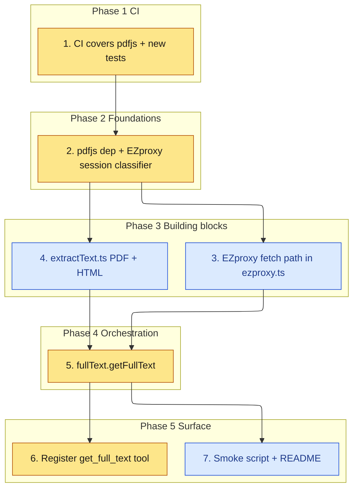

# Implementation Plan

Port the `get_full_text` full-text tool from closed PR #2 onto the current
session layer, wiring it into #5's cache, cookie scoping, and `login_required`
handling.

## Task graph

An arrow means depends-on. Primary critical path: 1, 2, 3, 4, 6.

## Tasks

- [x] 1. Update CI for the new dependency and tests
  - `.github/workflows/ci.yml` already runs `npm ci`, `npm run typecheck`,
    `npm run build`, `npm test`, and `npm pack --dry-run` on push and PR, which
    covers the added dependency and the new test files; no change needed
  - Gates every later task: it must pass before task 2 starts

- [x] 2. Add the PDF dependency and the EZproxy session classifier
  - Add `pdfjs-dist` pinned to `3.11.174` to `dependencies` in `package.json`
    and update `package-lock.json`
  - Add `classifyEzproxySession` and `EzproxySessionState` to `src/session.ts`,
    built on the existing `hasEzproxySession`/`hasOneSearchSession`/
    `isCookieExpired`; return `onesearch_only` when only OneSearch cookies exist
  - Do not change `classifySession` or any other #5 export
  - _Requirements: 2.1_

- [x] 3. Build the EZproxy fetch path in `src/ezproxy.ts`
  - Add `FULL_TEXT_LIMITS`, `toEzproxyFetchUrl`, `isBlockedHostname`,
    `isEzproxyLoginPage`, `absorbSetCookie`, the `FetchLike`/`ProxyFetchResult`
    types, and `fetchEzproxyResource`
  - Follow redirects manually, staying on `*.ezproxy.neu.edu`; treat an
    off-proxy redirect as `login_required`; apply cookies per host via #5's
    `cookieHeaderForHost`; enforce the byte cap and timeout
  - Keep the existing `normalizeDoi`/`doiToHttpsUrl`/`buildEzproxyDoiUrl` and
    `EZPROXY_*` exports working
  - _Requirements: 1.1, 2.2, 2.3, 3.4_

- [x] 4. Add `src/extractText.ts`
  - Port PDF text extraction via `pdfjs-dist` legacy build with the page cap,
    `htmlToText`, `findMetaContent`, `findPreferredPdfUrl`, `looksLikePdf`,
    `looksLikeHtml`, `looksLikePaywall`, `looksLikeBotWall`, `decodeBody`
  - Add `test/fixtures/tiny.pdf` from PR #2
  - _Requirements: 3.1, 3.2, 3.5, 3.6_

- [x] 5. Add `src/fullText.ts` orchestration
  - Implement `getFullText`: `resolveTarget` (DOI or `getRecord` + `mapDoc`),
    session gate via `classifyEzproxySession`, fetch via `fetchEzproxyResource`,
    PDF/HTML branch, `citation_pdf_url` re-routed through EZproxy, and the full
    status mapping; never place a cookie value in any field
  - Use #5's `loadStoredCookies` and `sessionCachePath` defaults
  - _Requirements: 1.2, 1.3, 1.4, 1.5, 2.1, 2.4, 3.1, 3.2, 3.3, 3.5, 3.6, 3.7_

- [x] 6. Register the `get_full_text` tool in `src/index.ts`
  - Add the tool with a `doi`/`recordId` zod input schema, call `getFullText`,
    and return the JSON result; keep the existing `LoginRequiredError` catch for
    the metadata lookup path
  - _Requirements: 1.3, 3.7_

- [ ] 7. Add the smoke script and README docs
  - Add `scripts/fulltext-smoke.mjs` targeting `dist/`, exiting non-zero on
    `login_required` or a non-text result
  - Document `get_full_text`, its inputs, statuses, and the smoke test in
    `README.md`
  - _Requirements: 4.1, 4.2_
