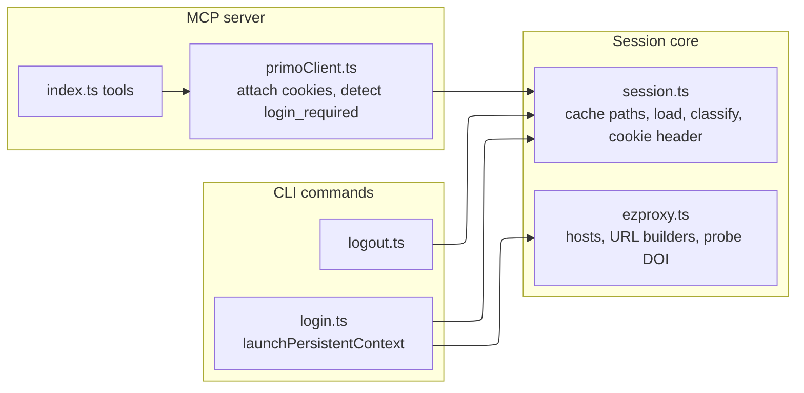
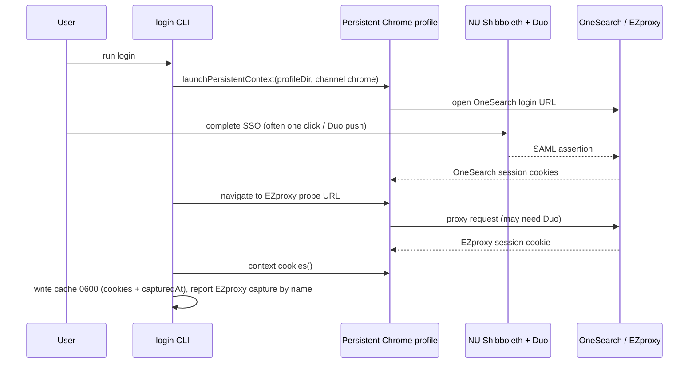
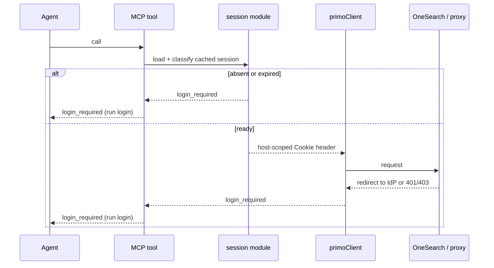
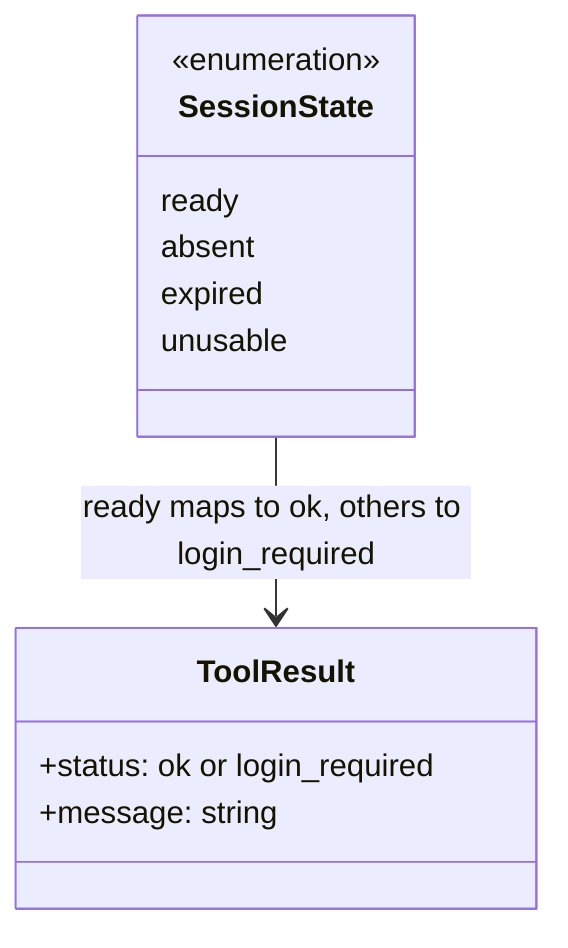
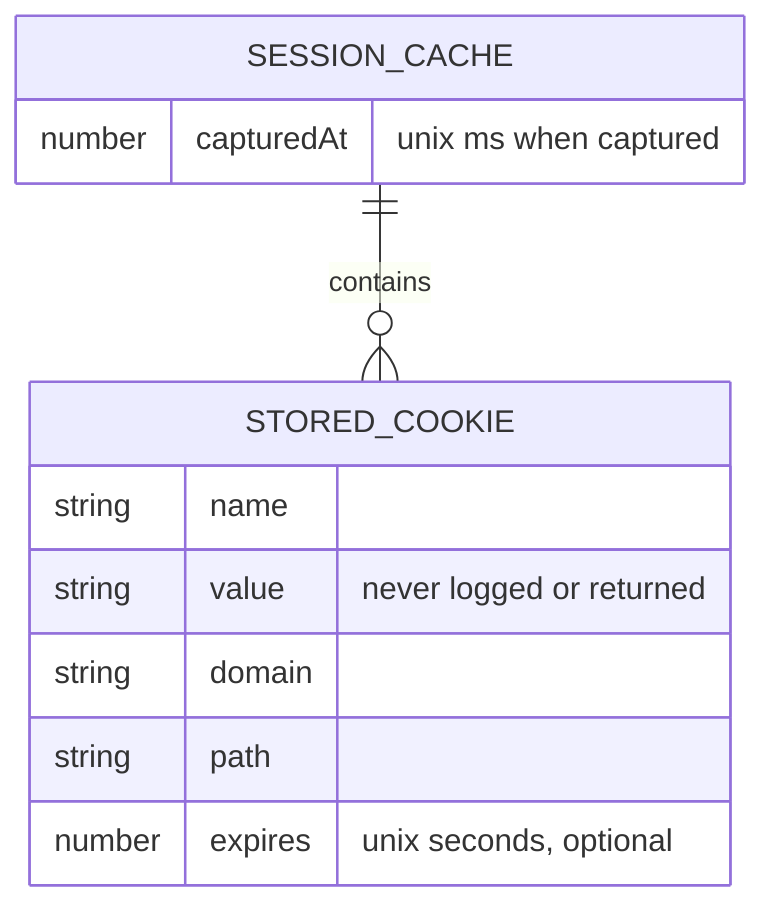
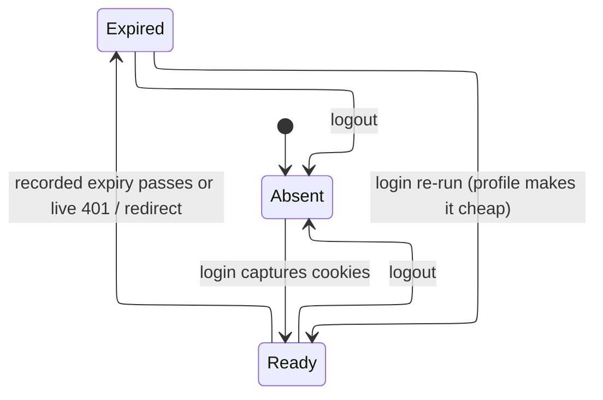
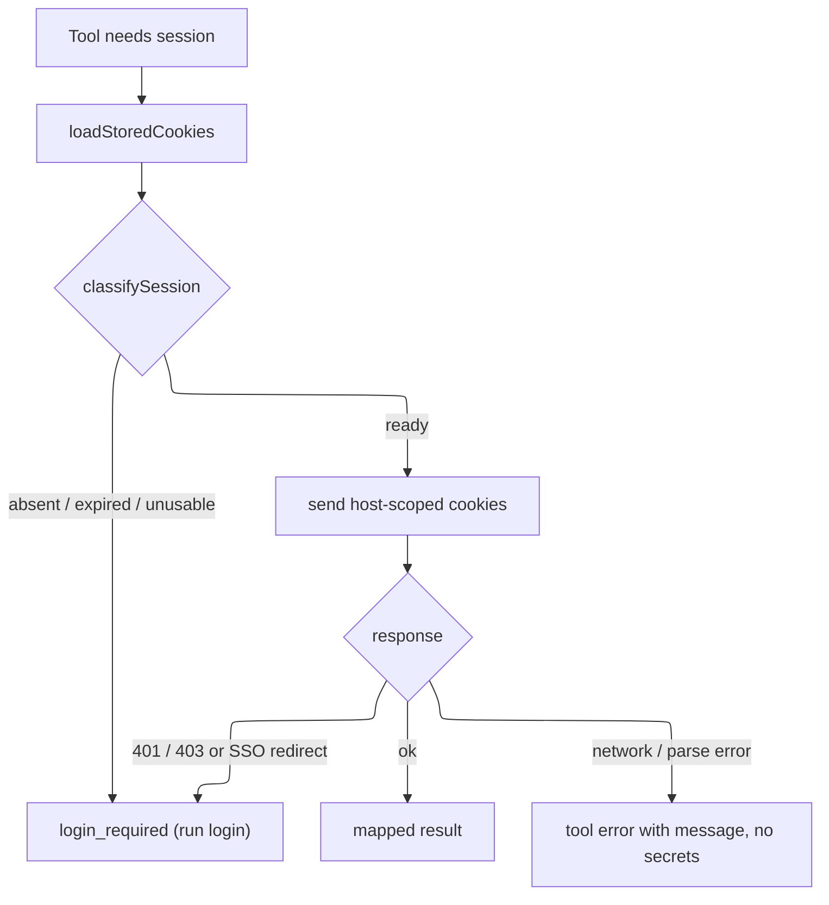

# Design

## Overview

Sign-in is a standalone CLI step (`login`), because NEU's Primo VE and EZproxy use SAML + Duo
with a fixed IdP redirect target; the MCP client cannot host a `127.0.0.1` OAuth callback, and
there is no refresh token (see `docs/superpowers/specs/2026-07-22-onesearch-auth-design.md`). The
`login` command drives a dedicated, persistent Playwright Chrome profile so the IdP session and
Duo "remember this device" survive between runs, making re-login cheap. Captured OneSearch and
EZproxy cookies plus a capture timestamp are cached owner-only on the user's device. A reusable
session module classifies the cache so any tool can reuse valid cookies and otherwise return a
clear `login_required` signal. `logout` removes the cache and the profile.

This spec covers Requirements 1–5. Requirement 1 (login, profile, owner-only cache, no secrets) and
Requirement 3 (cheap re-login, overwrite in place) are the `login` command plus the cache writer.
Requirement 2 (reuse, absent-safe, `login_required` on missing/expired/redirect/401) is the session
module and its wiring into `primoClient`. Requirement 4 (logout) is the `logout` command. Requirement 5
is README documentation.

Reuse from PR #2 (cursor/ezproxy-full-text-7e11), rebuilt on `main`: the EZproxy host-scoping and
cookie-header helpers (`isEzproxyHostname`, `cookieHeaderForHost`, expiry and `classifyEzproxySession`
logic) and the EZproxy URL builders (`EZPROXY_LOGIN_ORIGIN`, probe DOI, `buildEzproxyDoiUrl`). PR #2's
`newContext()` + `storageState()` approach is replaced by `launchPersistentContext` per issue #4, and
its separate `get_full_text`/extraction path is out of scope here.

### Decisions

| Decision | Why | Rejected alternative |
| --- | --- | --- |
| Cache lives at `~/.cache/neu-onesearch-mcp/` with profile `profile/` and cookies `session.json` | Matches issue #4's named path and XDG cache conventions; separates persistent profile from the small cookie snapshot | Keeping PR #2's `~/.neu-onesearch-mcp/session.json`; rejected to follow the issue's stated path |
| Honor `NEU_ONESEARCH_CACHE_DIR` override (path only) | Lets a remote/CI or test move the cache; keeps PR #2's override idea | A password or raw-cookie env var; rejected — never accept secrets via env |
| Cache is our own JSON (`{ cookies, capturedAt }`), not Playwright `storageState` | We own only the two cookie sets we need plus a timestamp; smaller, clearer, no `localStorage`/`sessionStorage` surface | Writing full `storageState`; rejected — more data than needed, and the persistent profile already holds the browser state |
| Read cookies with `context.cookies()` after sign-in | Persistent context exposes live cookies directly; no `storageState()` round-trip | `storageState()`; still available but unnecessary here |
| Expiry = recorded cookie expiry OR live redirect/401 signal; capture time stored but advisory | Cookie `expires` is authoritative when present; the live signal is the honest fallback for session cookies with no expiry. Avoids guessing a hard TTL | A fixed 1-hour timer that discards valid sessions or trusts dead ones; rejected per the auth design's "no pre-expiry guessing" |
| Wire `login_required` into `primoClient` via redirect/401 detection | Proves the contract end to end on `main` without `get_full_text`; `search_onesearch`/`get_record` stay anonymous in content but now surface auth loss instead of a silent empty result | Leaving the session module unwired until `get_full_text` lands; rejected — Requirement 2.4 needs a live consumer |
| `login`/`logout` are new bins (`neu-onesearch-login`, `neu-onesearch-logout`) | `login` bin already exists; `logout` follows the same pattern and is discoverable | A single multi-subcommand CLI; rejected — larger change, existing bin convention works |
| Only attach host-scoped cookies; never send `.northeastern.edu`/IdP cookies to publishers | Avoids leaking the IdP session across hosts; same guard PR #2 established | Sending the whole jar; rejected — security and correctness |
| Profile uses `channel: 'chrome'`, never the default user profile | Chrome blocks automation on the real profile and ties cookie encryption to it (issue #4) | `chromium` bundled browser or the user's profile; rejected per issue |

## Architecture



Login sequence:



Tool request with session loss:



## Components and Interfaces

New module `src/cache.ts` owns cache locations; `src/session.ts` owns cookie logic; `src/ezproxy.ts`
owns EZproxy URLs; `src/logout.ts` is the new CLI. TypeScript signatures the tasks implement:

```typescript
// cache.ts
export function resolveCacheDir(): string;          // NEU_ONESEARCH_CACHE_DIR or ~/.cache/neu-onesearch-mcp
export function profileDir(): string;               // <cacheDir>/profile
export function sessionCachePath(): string;         // <cacheDir>/session.json
export function ensureCacheDir(): void;              // mkdir 0700
export function removeSession(): { cacheRemoved: boolean; profileRemoved: boolean }; // logout

// session.ts
export interface StoredCookie { name: string; value: string; domain?: string; path?: string; expires?: number; }
export interface SessionCache { cookies: StoredCookie[]; capturedAt: number; }
export function writeSessionCache(cookies: StoredCookie[], capturedAt?: number, path?: string): void; // 0600
export function loadStoredCookies(path?: string): StoredCookie[] | null; // null if missing/unreadable/malformed
export function isCookieExpired(cookie: StoredCookie, nowMs?: number): boolean;
export function isEzproxyHostname(host: string): boolean;
export function hasEzproxySession(cookies: StoredCookie[], nowMs?: number): boolean;
export function hasOneSearchSession(cookies: StoredCookie[], nowMs?: number): boolean;
export type SessionState = 'ready' | 'absent' | 'expired' | 'unusable';
export function classifySession(cookies: StoredCookie[] | null, nowMs?: number): SessionState;
export function cookieHeaderForHost(cookies: StoredCookie[], host: string, path?: string, nowMs?: number): string | null;
export function loadSession(path?: string): string | null; // OneSearch Cookie header (back-compat with primoClient)

// ezproxy.ts (subset reused from PR #2)
export const EZPROXY_LOGIN_ORIGIN: string;          // https://link.ezproxy.neu.edu
export const EZPROXY_PROBE_DOI: string;             // open-access probe article
export function buildEzproxyDoiUrl(doi: string): string | null;

// login detection used by primoClient
export class LoginRequiredError extends Error {}
export function isLoginRedirect(response: Response): boolean; // 401/403, or redirect to a sign-in host
```

Session states and how tools map them:



The `login` CLI (`src/login.ts`) replaces today's `chromium.launch` + `newContext` with
`chromium.launchPersistentContext(profileDir(), { headless: false, channel: 'chrome' })`. It navigates to
the OneSearch login URL, waits for the user to confirm, navigates to the EZproxy probe URL to force an
EZproxy cookie, reads `context.cookies()`, filters to OneSearch- and EZproxy-scoped cookies, and calls
`writeSessionCache`. It reports captured EZproxy cookie names only. If `launchPersistentContext` throws
because the `chrome` channel is missing, it exits with a message naming Chrome (Requirement 1.6).

The `logout` CLI (`src/logout.ts`) calls `removeSession()` and prints what was removed; it never throws on
a missing path (Requirement 4.2).

`primoClient.ts` keeps attaching the OneSearch cookie header from `loadSession()`. It additionally treats a
response that `isLoginRedirect()` recognizes (HTTP 401/403, or a redirect to an SSO host) as
`LoginRequiredError`; `index.ts` maps that to a `login_required` tool result instead of a thrown error or an
empty list (Requirement 2.4).

## Data Models



On-disk layout (all under `resolveCacheDir()`, mode `0700`):

| Path | Mode | Contents |
| --- | --- | --- |
| `profile/` | `0700` (Chrome manages contents) | Playwright persistent Chrome profile: IdP session, Duo remember-device |
| `session.json` | `0600` | `{ "cookies": StoredCookie[], "capturedAt": number }` |

Session lifecycle:



## Error Handling



| Condition | Handling | Requirement |
| --- | --- | --- |
| Cache file missing/unreadable/malformed | `loadStoredCookies` returns `null`; classified `absent`; never throws | 2.2 |
| All session cookies expired | classified `expired` → `login_required` | 2.3 |
| Live redirect to SSO host or 401/403 | `LoginRequiredError` → `login_required` | 2.4 |
| Chrome channel missing at login | exit with message naming Chrome; no default-profile fallback | 1.6 |
| `logout` with nothing to remove | idempotent success | 4.2 |
| Any error path | message carries no password and no cookie value | 1.4, 1.5 |

## Testing Strategy

Unit tests only; no live NU sign-in runs (no credentials available). The browser/IdP is mocked. Vitest is
the existing runner.

- `cache.ts`: `resolveCacheDir` honors the env override and default; `ensureCacheDir` creates `0700`;
  `removeSession` deletes cache + profile and is idempotent when absent. Use a temp dir via the env override.
- `session.ts`: `writeSessionCache` writes `0600` and round-trips through `loadStoredCookies`;
  malformed/missing/empty files yield `null`; `isCookieExpired`, `hasEzproxySession`, `hasOneSearchSession`,
  `classifySession` across ready/absent/expired/unusable; `cookieHeaderForHost` attaches only host-scoped,
  unexpired cookies and never cross-domain cookies; `loadSession` still returns the OneSearch header.
- `ezproxy.ts`: `buildEzproxyDoiUrl` for valid/invalid DOIs; probe URL shape.
- login detection: `isLoginRedirect` true for 401/403 and SSO-host redirects, false for normal 200.
- `primoClient.ts` / `index.ts`: with an injected fetch returning a 401 or an SSO redirect, the tool result
  is `login_required`; with a normal response, results match today; with no cache file, behavior is the
  anonymous baseline (Requirement 2.5). The MCP tool wiring returns `login_required` text, not a thrown error.
- `login.ts`/`logout.ts` browser interaction is not unit-tested beyond the cache-writing and removal helpers
  they call; the interactive sign-in is a documented manual smoke test. No cookie value appears in any test
  fixture or assertion message.

Left for a human: one live sign-in smoke test on a machine with Chrome and NU credentials — run `login`,
confirm the EZproxy-captured line, confirm a tool reuses the session, let it expire and confirm
`login_required`, then `logout` and confirm the profile and cache are gone. This also measures the real
session lifetime to replace the "about one hour, to verify" note in the README.
