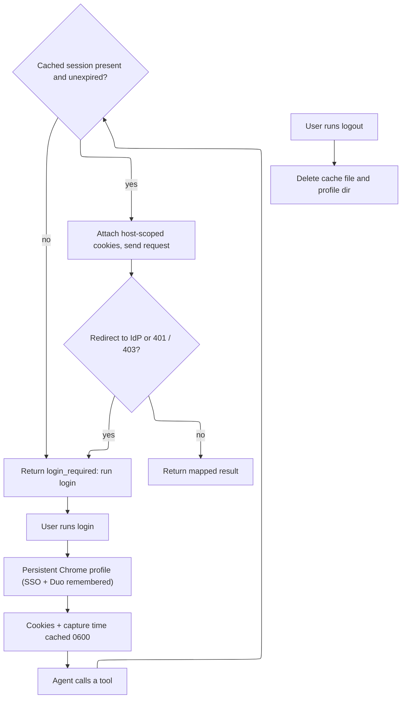

# Requirements Document

## Introduction

This spec adds browser-driven Northeastern SSO (Shibboleth SAML + Duo) sign-in to the
OneSearch MCP server, following issue #4. A student signs in once through a dedicated,
persistent Playwright Chrome profile; the resulting OneSearch and EZproxy session cookies
are cached on their own device so MCP tools can reuse them without asking for a password.

Scope: the `login` and `logout` CLI commands, the persistent Chrome profile, the owner-only
on-disk cache (cookies plus capture time), and a reusable session layer that classifies the
cached session so tools can return a clear `login_required` signal when it is missing or
expired. The session layer is wired into the existing `search_onesearch`/`get_record` request
path only far enough to prove the `login_required` contract end to end (a login redirect or
`401`/`403` surfaces `login_required`, never a silent failure).

Out of scope, deferred to their own specs: the `get_full_text` tool and article extraction
(issue #2 / PR #2); a remote HTTP transport, an OAuth-to-SAML shim, or a browser extension that
posts cookies to a local endpoint (issue #1 — the README documents the remote/Tailscale path as
guidance only). No passwords are ever collected, stored, or logged. The package stays published;
this change does not bump the version or publish.

Decisions that set scope are recorded one per line here; technical calls are in `design.md`.
Assumed session lifetime for v1 is about one hour (documented as "measured/verify"); no
proactive timer-based expiry beyond honoring recorded cookie expiry and the live redirect/401
signal.

## Requirements

### Requirement 1

**User Story:** As a Northeastern student, I want to sign in once through a real browser, so that
the MCP server can reuse my library session without ever handling my password.

#### Acceptance Criteria

1. WHEN the user runs the `login` command THEN the system SHALL open a visible Chrome window
   (Playwright `launchPersistentContext`, `channel: 'chrome'`) on a dedicated profile directory
   separate from the user's everyday Chrome profile.
2. WHEN the sign-in completes in that window THEN the system SHALL read the OneSearch and EZproxy
   session cookies from the browser context and write them, with the capture time, to the cache file.
3. WHEN the system writes the cache THEN the system SHALL create the cache directory with mode `0700`
   and the cache file with mode `0600`, and SHALL place both outside the repository working tree.
4. WHEN the system completes a login THEN the system SHALL NOT write, print, or log any password,
   and SHALL NOT print any cookie value.
5. WHEN login finishes THEN the system SHALL report whether an EZproxy session cookie was captured,
   by cookie name only, never by value.
6. IF Chrome (the `chrome` channel) is not installed THEN the system SHALL fail with a clear message
   naming Chrome as the missing dependency, and SHALL NOT fall back to the user's default profile.

### Requirement 2

**User Story:** As an agent calling the MCP tools, I want the cached session reused automatically and
an explicit signal when it is gone, so that I never act on a silently failed request.

#### Acceptance Criteria

1. WHEN a tool request runs and the cache holds unexpired session cookies THEN the system SHALL attach
   only cookies scoped to the matching host and SHALL NOT attach cookies scoped to unrelated parent
   domains.
2. WHEN the cache file is missing, unreadable, or malformed THEN the system SHALL treat the session as
   absent and SHALL NOT throw.
3. WHEN the session is absent or all recorded session cookies are expired THEN a tool that needs the
   session SHALL return a `login_required` result with a human-readable message telling the user to run
   `login`.
4. WHEN a request that carried the session is answered with a sign-in redirect or an HTTP `401`/`403`
   THEN the system SHALL return `login_required` and SHALL NOT present the redirect or error as a
   successful or empty result.
5. WHEN the session is present and valid THEN tool behavior SHALL CONTINUE TO match today's anonymous
   behavior for `search_onesearch` and `get_record` (same mapped results), since those tools do not
   depend on the session for their content.

### Requirement 3

**User Story:** As a returning student, I want re-login after expiry to be fast, so that I rarely retype
my password or redo full Duo.

#### Acceptance Criteria

1. WHEN the user runs `login` again while the NU IdP session in the persistent profile is still alive
   THEN the system SHALL reuse that profile so sign-in typically needs no password (at most one Duo
   confirmation).
2. WHEN a tool returns `login_required` THEN the message SHALL name the `login` command as the next step.
3. WHEN `login` re-runs THEN the system SHALL overwrite the existing cache file in place, keeping its
   `0600` mode.

### Requirement 4

**User Story:** As a privacy-conscious user, I want a one-command sign-out, so that I can remove my
cached session and profile from the device.

#### Acceptance Criteria

1. WHEN the user runs the `logout` command THEN the system SHALL delete the cache file and the persistent
   profile directory.
2. WHEN `logout` runs and neither the cache nor the profile exists THEN the system SHALL report success
   (idempotent) and SHALL NOT throw.
3. WHEN `logout` completes THEN a subsequent tool call that needs the session SHALL return `login_required`.

### Requirement 5

**User Story:** As someone setting this up, I want the README to tell me how sign-in works, how long a
session lasts, and how to run it on a remote box, so that I can operate it beyond my own laptop.

#### Acceptance Criteria

1. WHEN a user reads the README THEN it SHALL document the `login` and `logout` commands, the dedicated
   profile, and the cache location with its owner-only permissions.
2. WHEN a user reads the README THEN it SHALL state the session lifetime as observed for v1 (about one
   hour, noted as to be verified) and that expiry surfaces as `login_required`.
3. WHEN a user reads the README THEN it SHALL describe the remote/Tailscale path (sign in on the server
   over a remote desktop; a future cookie-posting extension) as the way to use this on a machine without
   an interactive display.

## User and session flow

