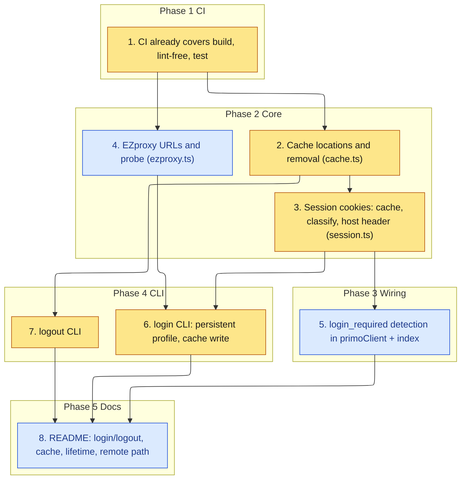

# Implementation Plan

Adds browser SSO sign-in with a persistent Chrome profile, an owner-only cached session, a
`login_required` contract wired into the existing tools, and a `logout` command.

## Task graph

An arrow means depends-on. Primary critical path: 1, 2, 3, 6, 7.



## Tasks

- [x] 1. CI workflow for build and test
  - `.github/workflows/ci.yml` already runs `npm ci`, `npm run typecheck`, `npm run build`, `npm test`, and `npm pack --dry-run` on push and pull request; it covers every path this spec touches (new `src/*.ts`, `test/*.test.ts`)
  - The project has no linter, so no lint step is added (do not invent one)
  - Gates every later task: it must pass before task 2 starts

- [x] 2. Cache locations and removal
  - Add `src/cache.ts`: `resolveCacheDir` (honor `NEU_ONESEARCH_CACHE_DIR`, else `~/.cache/neu-onesearch-mcp`), `profileDir`, `sessionCachePath`, `ensureCacheDir` (mkdir `0700`), `removeSession` (delete cache file and profile dir, idempotent)
  - _Requirements: 1.3, 4.1, 4.2_

- [x] 3. Session cookie cache, classification, and host-scoped header
  - Add/extend `src/session.ts`: `StoredCookie`, `SessionCache`, `writeSessionCache` (`0600`), `loadStoredCookies` (null on missing/unreadable/malformed), `isCookieExpired`, `isEzproxyHostname`, `hasEzproxySession`, `hasOneSearchSession`, `classifySession` (`ready|absent|expired|unusable`), `cookieHeaderForHost` (host-scoped, unexpired only), keep `loadSession` for OneSearch
  - _Requirements: 1.2, 2.1, 2.2, 2.3, 3.3_

- [x] 4. EZproxy URLs and probe DOI
  - Add `src/ezproxy.ts`: `EZPROXY_LOGIN_ORIGIN`, `EZPROXY_PROBE_DOI`, DOI normalization, `buildEzproxyDoiUrl`; reused from PR #2, trimmed to what login needs
  - _Requirements: 1.2_

- [x] 5. Surface login_required from the request path
  - Add `LoginRequiredError` and `isLoginRedirect` (401/403 or SSO-host redirect); make `primoClient` raise it; map it in `index.ts` tool handlers to a `login_required` result instead of a thrown error or empty list; keep valid-session and anonymous behavior unchanged
  - _Requirements: 2.3, 2.4, 2.5, 3.2_

- [ ] 6. login CLI with persistent Chrome profile
  - Rewrite `src/login.ts` to use `launchPersistentContext(profileDir(), { headless: false, channel: 'chrome' })`, navigate OneSearch then the EZproxy probe, read `context.cookies()`, write the cache via `writeSessionCache`, report captured EZproxy cookie names only (never values), and fail with a Chrome-naming message if the channel is missing
  - _Requirements: 1.1, 1.2, 1.4, 1.5, 1.6, 3.1, 3.3_

- [ ] 7. logout CLI
  - Add `src/logout.ts` bin calling `removeSession`, printing what was removed, idempotent; register `neu-onesearch-logout` in `package.json` bin and build chmod
  - _Requirements: 4.1, 4.2, 4.3_

- [ ] 8. Document sign-in, session lifetime, and the remote path
  - Update README: `login`/`logout` commands, dedicated profile, cache path and `0700`/`0600` permissions, session lifetime (about one hour, to verify) surfacing as `login_required`, and the remote/Tailscale guidance; note the live smoke test is a manual human step
  - _Requirements: 5.1, 5.2, 5.3_
```
